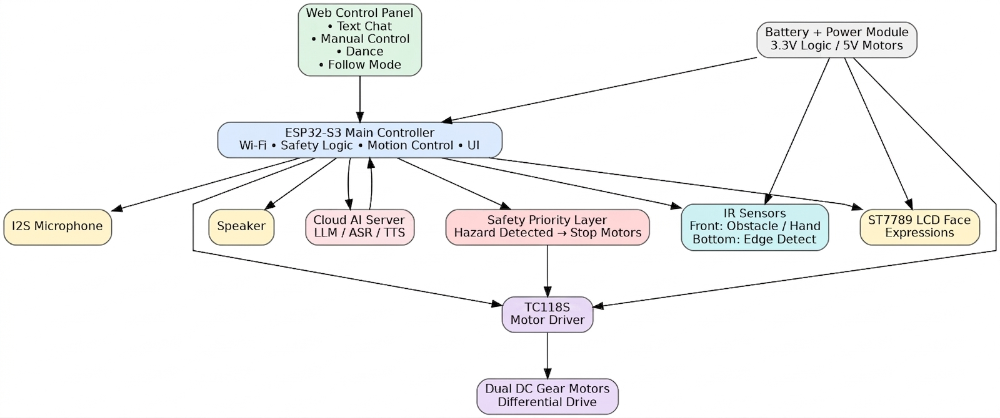

# Week 3 Engineering Notebook

**Date:** March 2 – March 8

## Objectives

- Stand up a working ESP32-S3 dev-board sandbox so I can run the state machine module on real hardware before the custom PCB returns.
- Bring up the xiaozhi-esp32 framework on the dev board and confirm the wake-word path is reachable.
- Define the WebSocket JSON schema for the web panel so the front-end work can start in parallel.
- Continue PCB schematic review with Zichao (round 1) and reserve sensor windows with Yuchen.

## Work Completed

This week was mostly bring-up. I flashed an ESP32-S3 dev board with a baseline xiaozhi-esp32 build and confirmed it boots, joins Wi-Fi, and reaches the local backend. Once the framework was alive, I wired in the state machine stub from Week 2 as a separate component so I could exercise transitions over the USB serial console without touching xiaozhi internals.

I also wrote the first version of the WebSocket schema for the web panel:

```
// device → panel
{ "kind": "status", "mode": "ai" | "human_control", "state": "idle" | ... }
{ "kind": "log",    "msg": "..." }

// panel → device
{ "kind": "cmd", "type": "MOVE" | "STOP" | "SET_MODE" | "DANCE", "arg": "..." }
```

Why this matters: agreeing on the message shape now lets me build the device side and stub a panel page in parallel without renegotiating later. The schema also matches the `command_t` struct from Week 2 one-to-one, so the parser stays small.

Discussion with Zichao on the schematic round 1:

- Walked through the ESP32-S3 module pinout (audio, USB, key, LED, LCD, UART, ToF) and confirmed it matches the firmware pin map.
- Flagged that the current draft labels cliff sensors as "ToF" although we agreed to start with IR; he updated the silkscreen note for the next revision.
- Confirmed `BOOT` (IO0) doubles as a runtime button.

Discussion with Yuchen on the head/body sketch:

- He showed the first head model with the LCD opening; it lines up with the FPC tail direction in Zichao's schematic.
- We talked about the front cliff sensor window placement — it has to clear the wheel base in front of the body so the IR reflection is from the desk surface, not from the wheel.

## Design Notes

### Dev-board sandbox

- Using a stock ESP32-S3 dev board until the custom PCB returns.
- The xiaozhi-esp32 build is configured to talk to a local backend on my Mac for ASR/LLM/TTS.
- The state machine module is wrapped behind a `robot_core` component; xiaozhi tool calls and a debug serial console both push events into it.

### WebSocket schema

- All messages are JSON with a `kind` discriminator.
- `cmd` from the panel maps directly to `command_t`.
- `status` from the device is sent on every state transition, so the panel can render mode and state without polling.

### Hardware notes from Zichao discussion

- Round 1 of the PCB has `EDGE_FRONT/EDGE_RARE` on `IO17/IO18` as agreed.
- The audio PA (`NS4150B`) has a `PA_CTL` line tied to a GPIO so the firmware can mute it during boot, which I will need for the LCD/PA pop-noise issue later.
- Power routing: USB 5V and battery via diode ORing, with an LDO to 3.3V. The mic gets its own RC-isolated 3.3V rail.

### Exterior notes from Yuchen discussion

- Head opening is sized for the LCD plus a 1 mm bezel.
- Front cliff sensor sits behind a thin slot under the front lip, angled straight down.
- He is keeping the head a bit wider than the body so the LCD reads as a "face" rather than a panel.

### Tradeoffs noted

- Local backend vs. cloud for ASR: local Mac wins for now because it cuts round-trip latency and lets me iterate without cloud quotas. We can swap in a cloud endpoint later by changing one URL.
- WebSocket vs. plain HTTP for the panel: WebSocket lets the device push state changes; HTTP would force polling and waste cycles.

## Diagrams and Figures



**Figure 1. System block diagram (re-used from Week 1) showing the ESP32-S3 main controller, the web panel input path, Wi-Fi + safety logic, I2S microphone, speaker, cloud AI server, safety priority layer, IR sensors, ST7789 LCD face, TC118S motor driver, and battery / power module.**

I am keeping Figure 1 in this week's notes because the bring-up work this week mapped the architecture onto a real dev board for the first time. As shown in Figure 1, the "Web Panel Inputs" block connects to the ESP32-S3 directly over Wi-Fi, while audio flows through the cloud AI server (running on my laptop for now). The arrows in Figure 1 are exactly the data paths I exercised this week: web panel → device for commands, device → server → device for the voice loop.

## Equations and Calculations

Rough end-to-end latency budget for the voice path:

\[
L_{e2e} = L_{wake} + L_{stream} + L_{ASR} + L_{LLM} + L_{TTS} + L_{play}
\]

**Equation 1. End-to-end latency from wake word to first audio out.**

Where:
- \(L_{wake}\) is wake-word detection time on device.
- \(L_{stream}\) is audio streaming + network time to the backend.
- \(L_{ASR}\) is automatic speech recognition time.
- \(L_{LLM}\) is LLM response time (the largest term in practice).
- \(L_{TTS}\) is text-to-speech generation time.
- \(L_{play}\) is buffering + playback start time on device.

This is just for tracking; concrete values per term are filled in as `[latency result]` once I instrument the path next week.

## Testing and Debugging

### Test 1: Dev-board sandbox boot and Wi-Fi

**Goal:** Confirm the dev board boots the xiaozhi build and reaches the local backend.

**Setup:** Stock ESP32-S3 dev board over USB-C, laptop running the local backend, both on the same Wi-Fi.

**Input Conditions:** Power on, watch serial.

**Expected Result:** Wi-Fi connects, websocket to backend opens, wake-word detector reports ready.

**Observed Result:** All three happen on first boot.

**Analysis:** Build is healthy.

**Decision / Next Step:** Layer the `robot_core` component on top.

### Test 2: State machine driven over serial console

**Goal:** Confirm that pushing fake events into the state machine on real hardware behaves the same as the host harness.

**Setup:** Dev board running `robot_core`, debug commands typed into the serial console.

**Input Conditions:** `evt wake`, `evt cmd_forward`, `evt cliff_front`, `evt cliff_clear`, `evt recover_timeout`.

**Expected Result:** End state `IDLE`, with `SAFETY_STOP` visited once.

**Observed Result:** Matches expected.

**Analysis:** Module behaves identically on device and on host, which is the whole point of separating it.

**Decision / Next Step:** Wire xiaozhi MCP tool calls into the same event queue.

### Test 3: WebSocket schema round-trip

**Goal:** Confirm that a hand-typed JSON `cmd` from a browser console drives a state transition.

**Setup:** Tiny static HTML page served from the dev board with one `<input>` and a `WebSocket` object.

**Input Conditions:** `{"kind":"cmd","type":"MOVE","arg":"FORWARD"}`.

**Expected Result:** Device logs the command, transitions out of `IDLE`, and pushes a `status` message back.

**Observed Result:** Works, but the round trip takes `[latency result]` ms; need to measure properly next week.

**Analysis:** Path is alive. Latency feels fine for manual driving.

**Decision / Next Step:** Build a real panel UI on top of this skeleton.

## Problems and Proposed Solutions

**Problem:** Wake word fires on background TV audio during testing.
- **Evidence:** Two false wakes during a 10 minute idle session.
- **Possible cause:** Default sensitivity in xiaozhi config.
- **Proposed solution:** Bump the wake-word threshold and re-test in a quieter setting next week. Not blocking right now.

**Problem:** Serial console event injection is convenient but easy to forget; risk of leaving a debug command in the build.
- **Proposed solution:** Gate the serial event injector behind a build flag so it cannot ship in a release build.

## Revisions

- Pin map: confirmed against Zichao's schematic round 1; updated silkscreen note (IR, not ToF) for round 2.
- Architecture: `robot_core` separated from xiaozhi internals so it can be unit-tested on host.
- Web panel schema: first version locked, matches `command_t` 1:1.

## Next Steps

- Implement the first real web panel page (manual D-pad + mode toggle).
- Add latency instrumentation to each segment of Equation 1 so I can fill in real numbers.
- Wire xiaozhi MCP tool calls (`robot.move`, `robot.set_mode`) into `robot_core` events.
- Re-check Zichao's schematic round 2 once it lands and reserve any newly added GPIOs.
- Confirm with Yuchen the front cliff sensor angle once he prints the first body draft.
