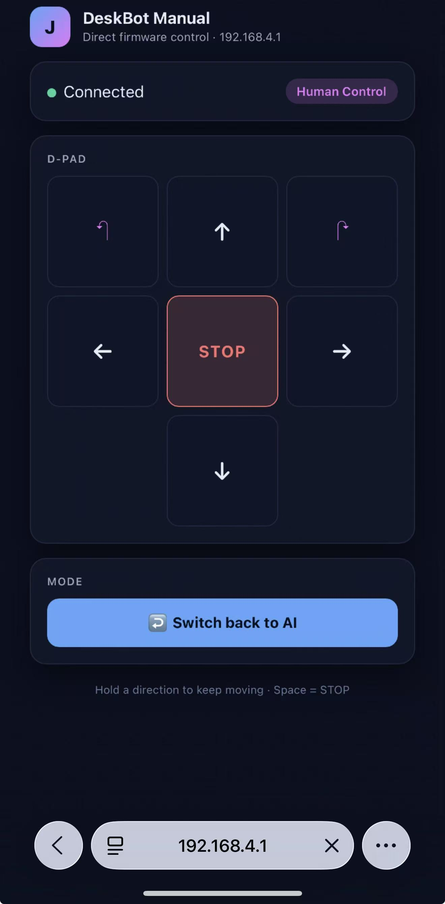

# Week 7 Engineering Notebook

**Date:** March 30 – April 5

## Objectives

- Bring up firmware on the manufactured PCB once it arrives.
- Replace the logged-only motor commands with real PWM.
- Confirm cliff sensor input on real GPIOs and integrate it into the safety latch.
- Sit in on Yuchen's PCB-driven exterior layout pass; confirm sensor windows match the new chassis.

## Work Completed

The first PCB arrived this week. Coming into bring-up, my goal was to get to "robot drives on the desk and the LCD reflects state" without rewriting any of the modules I had already validated on the dev board.

What I did, in order:

1. Powered the board over USB, confirmed 3.3 V on the ESP32-S3, and confirmed the device enumerates as a USB-Serial/JTAG device.
2. Flashed the existing build; the board booted, joined Wi-Fi, and the web panel was reachable on the first try.
3. Plugged in the LCD via the FPC connector. Faces rendered after a small SPI mode tweak (CPOL/CPHA was off vs. the dev-board setup).
4. Connected the motor harness to the body PCB's `XH2.54` connectors, set both PWMs low, then ran a manual `MOVE` sequence from the web panel. Both motors responded.
5. Plugged in the front and rear IR cliff sensors. Both produce digital output as expected. I added the actual GPIO read to the safety module so a real cliff event now raises the safety latch on the device.

This is the first time the full firmware has run with real motors and real sensors. Most modules behaved exactly as the host tests predicted, which is the payoff for the host-side test harness from earlier weeks.

Discussion items with Zichao on bring-up:

- We confirmed the motor power rail (`VBAT_OUT`) sags noticeably on motor start — visible on a scope but not enough to brown out the MCU because the digital rail comes through the LDO with bulk decoupling. This matches his prediction.
- He pointed out that the cliff IR module has its own LED indicator that I can use as a visual sanity check during desk testing.

Discussion items with Yuchen on the PCB-driven exterior pass:

- He measured the manufactured PCB and adjusted the chassis. The first fitting test of the actual board into the body went smoothly (his weekly note confirms the fit).
- We agreed the cliff sensor windows in the body align correctly with the IR modules now mounted on the body PCB.

## Design Notes

### Bring-up order

I deliberately powered things in this sequence: 3.3 V → boot → LCD → motors → sensors. The reason is that any failure earlier in the chain is easier to diagnose than a failure with everything energized at once.

### Motor PWM integration

- LEDC peripheral with two timers, four channels.
- Frequency 20 kHz to stay inaudible.
- Driver inputs are wired so PWM goes on one input, direction on the other (per the TC118S discussion in Week 6).
- Speed mapping uses Equation 1 from Week 2.

### Safety latch on real GPIOs

- `EDGE_FRONT` (IO17) and `EDGE_RARE` (IO18) are read with internal pull-ups.
- Software debounce: a sample must hold for 20 ms before a cliff event is raised.
- Once raised, the safety latch only clears after sensors are clean for a recovery timeout.

### Hardware notes from Zichao discussion

- `VBAT_OUT` sag on motor start is real but tolerated by the design.
- The cliff IR modules have built-in indicator LEDs — a quick desk-edge check is to slide the robot off the edge and watch the LED.

### Exterior notes from Yuchen discussion

- Chassis matches the actual PCB.
- Cliff sensor windows align.

### Tradeoffs noted

- Hardware vs. software debounce on cliff sensors: software-only is fine because the sensor module already has its own analog comparator. Adding hardware debounce would just add cost without changing the behavior.
- 20 kHz vs. 25 kHz PWM: I picked 20 kHz because it is a clean round number and well above audible. We can shift if EMC testing flags it.

## Diagrams and Figures

**Figure 1. DeskBot Manual web panel (the same v1 page from Week 4) running against the manufactured PCB at `192.168.4.1`. The panel shows "Connected" and the "Human Control" mode pill, and was used to drive the first motor commands on real hardware.**

I reused the panel from Week 4 against the new board so I could exercise motor commands the moment power, boot, and LCD bring-up cleared. As shown in Figure 1, the same `Connected` indicator and `Human Control` pill that worked against the dev board worked against the production board on first try, which made the motor wiring and direction-polarity issue easy to isolate (the WebSocket layer was clearly fine, so the bug was further down).

## Equations and Calculations

PWM frequency for the LEDC peripheral:

\[
f_{PWM} = \frac{f_{clk}}{N \cdot 2^{R}}
\]

**Equation 1. LEDC PWM frequency relation.**

Where:
- \(f_{clk}\) is the LEDC source clock.
- \(N\) is the timer divider.
- \(R\) is the resolution in bits.

For 20 kHz with `[measured]` clock and reasonable resolution, this resolves cleanly within the LEDC limits.

Cliff debounce minimum stable time:

\[
t_{stable} = N_{samples} \cdot T_{sample}
\]

**Equation 2. Debounce stable time = samples × per-sample period.**

Where:
- \(N_{samples}\) is the number of consistent samples required.
- \(T_{sample}\) is the per-sample period (we are sampling at `[sensor reading]` Hz).

I currently require ~20 ms of consistent reading; we can tighten this later.

## Testing and Debugging

### Test 1: First PCB power-on and boot

**Goal:** Confirm the manufactured board boots the existing build with no firmware changes.

**Setup:** PCB on bench, USB-C to laptop, LDO + ESP32-S3 only. No motors or sensors yet.

**Input Conditions:** Power on, watch serial log.

**Expected Result:** Same boot log as the dev board.

**Observed Result:** Same log. Wi-Fi joins, websocket opens.

**Analysis:** Hardware bring-up clean to this point.

**Decision / Next Step:** Plug in the LCD.

### Test 2: LCD on the FPC connector

**Goal:** Confirm the LCD renders faces from the FPC.

**Setup:** PCB + LCD via FPC.

**Input Conditions:** Cycle through all seven states from the serial console.

**Expected Result:** Each state renders.

**Observed Result:** First boot showed nothing on screen. After flipping `CPOL/CPHA` in the SPI config to match this LCD's wiring, faces render.

**Analysis:** SPI mode mismatch with the breakout I had been using on the dev board.

**Decision / Next Step:** Keep the new SPI config; document it.

### Test 3: Motor drive over web panel

**Goal:** Confirm both motors respond to D-pad commands.

**Setup:** PCB + motor harness + battery.

**Input Conditions:** Tap forward, back, left, right, stop.

**Expected Result:** Motors drive in the expected direction at a slow speed.

**Observed Result:** Forward/back work cleanly. One motor turned the wrong way for "left" on the first try.

**Analysis:** Direction polarity wired opposite for one channel.

**Decision / Next Step:** Inverted the direction signal for that channel in firmware. Re-test passes.

### Test 4: Cliff sensor → safety latch

**Goal:** Confirm a real cliff event raises the latch and stops motion.

**Setup:** PCB + IR cliff modules + motor harness. Robot on the bench, held over the edge.

**Input Conditions:** Slide the robot off a desk edge while moving forward.

**Expected Result:** Forward motion stops within `[latency result]` ms; LCD switches to `safety_stop`.

**Observed Result:** Both happen. Recovery requires sensor to stay clear for the timeout.

**Analysis:** Safety latch works on real hardware as designed.

**Decision / Next Step:** Tighten the debounce window once we are sure the IR module is stable.

## Problems and Proposed Solutions

**Problem:** LCD blank on first PCB boot.
- **Evidence:** Test 2 above.
- **Possible cause:** SPI mode mismatch with the production LCD vs. the breakout.
- **Proposed solution:** Set `CPOL/CPHA` for the production LCD. Done.

**Problem:** One motor channel turned the wrong way.
- **Evidence:** Test 3.
- **Possible cause:** Wiring polarity inverted for that channel.
- **Proposed solution:** Invert in firmware (cheaper than rewiring). Done.

**Problem:** `VBAT_OUT` sag on motor start visible on scope.
- **Evidence:** Discussion with Zichao.
- **Possible cause:** Inrush current.
- **Proposed solution:** Tolerated for now because the digital rail is isolated through the LDO. If we ever see an MCU reset on motor start, increase bulk capacitance.

## Revisions

- Firmware: SPI mode adjusted for production LCD.
- Firmware: motor channel direction inverted in the speed map for the misw wired channel.
- Firmware: cliff sensor GPIOs wired into the safety module with 20 ms software debounce.
- Build: production PCB build flag added so I can keep the dev-board flag separate.

## Next Steps

- Real motor / real cliff regression on the production PCB.
- Re-test the dance routine on real motors and tune the table for the actual chassis weight.
- Wire up follow mode's direction-of-arrival hint (single-mic energy heuristic) and see whether it is usable.
- Coordinate with Yuchen on the next assembled body so I can run on-chassis tests.
- Double-check Zichao's round 3 schematic against actual board behavior — flag any discrepancies for the report.
