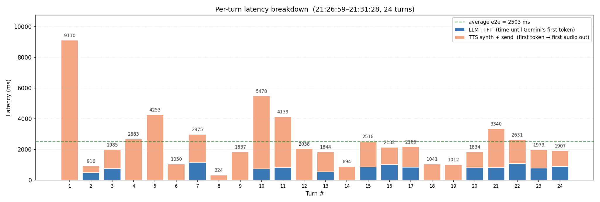

# Week 8 Engineering Notebook

**Date:** April 6 – April 12

## Objectives

- Run the dance routine on real motors and re-tune the table for actual chassis weight.
- Implement follow mode v1 using a single-mic energy heuristic.
- Run a full battery-powered session and check whether anything regresses vs. USB.
- Sync with Yuchen on the trial assembly week (head/body fitting, screen/mic/speaker openings).

## Work Completed

This week was mostly tuning rather than building. With real motors, several values that were guesses before now have real numbers.

Dance re-tune:

- The original `(duration, left, right)` table was tuned by feel on a motorless dev board. On the real chassis, the rows that involved sharp turns over-rotated.
- I shortened turn durations and dropped peak duty by a small amount. New table feels coherent on the desk.
- Dance still preempts cleanly on cliff events.

Follow mode v1:

- Signal source: per-frame VAD energy from the existing single mic. There is no DOA from one mic, so I use a simple heuristic: when energy crosses a threshold, the robot rotates a fixed amount toward the user's last command direction (passed in as a hint at mode entry), then pauses.
- This is intentionally modest. Without an array, real DOA is not honest.
- Mode exit returns to `IDLE` and clears any pending rotation.

Battery vs. USB regression:

- Ran a 30-minute session on battery only (no USB).
- Voice path works. ASR latency is similar to USB.
- Noticed that wake word felt slightly less responsive on battery in one corner of the room. Not yet root-caused — could be Wi-Fi RSSI rather than power.
- LCD/motor/cliff stack behaved identically.

Discussion with Yuchen during the trial assembly week:

- He fitted the PCB into the new body and added head openings for the screen, microphone, and speaker.
- We checked that the LCD opening framed the face correctly with no visible bezel from typical desk-viewing distance.
- We agreed the mic opening is small enough to look clean but large enough not to dampen voice capture.

## Design Notes

### Dance table re-tune procedure

- Run dance, watch end pose, adjust turn durations and peak duty, repeat.
- Keep a copy of the previous table per iteration so I can roll back if a tweak overshoots.
- Final table is committed alongside this week's notes.

### Follow mode v1

- Mode entry hint: the user's last directional intent (from voice or web) is captured and used as the rotation direction.
- Energy threshold is conservative; I prefer to not rotate than to rotate on a fan or background voice.
- Each "step" rotates a small fixed angle, then pauses for a short window before the next decision.

### Battery session notes

- Voltage sag during motor activity is visible but does not reset the MCU.
- LDO and isolated mic rail behave as designed.
- Wi-Fi RSSI in different rooms varies; this might explain the wake-word sensitivity drop more than power does.

### Hardware notes from Zichao discussion

- He confirmed that the battery rail has a P-MOSFET load switch, so when the slide switch is off, the motor rail is fully de-energized — the wake-word effect on battery is unlikely to be a power-rail issue at the MCU.

### Exterior notes from Yuchen discussion

- Head openings (screen, mic, speaker) all sized correctly for the modules.
- LCD framing looks clean.

### Tradeoffs noted

- Single-mic follow vs. mic-array follow: mic-array is the right answer for real DOA, but we are not changing hardware now. Single-mic energy heuristic is honest about its limits.
- Conservative vs. sensitive energy threshold: I picked conservative because false rotations are more annoying than missed ones.

## Diagrams and Figures

**Figure 1. Per-turn end-to-end voice latency over a 24-turn session (21:26:59 – 21:31:28). Bars are stacked by `LLM TTFT` (blue) and `TTS synth + send` (orange). Average end-to-end latency across the session is `2503 ms` (dashed green line). Per-turn values range from `324 ms` (turn 8) to `9110 ms` (turn 1).**

This is from the long-session run on the assembled robot this week. As shown in Figure 1, the LLM time-to-first-token term is consistently small relative to the TTS synth + send term — so the dominant contributor for short commands is the TTS path, not the LLM, which is the opposite of what I had been assuming from earlier short samples. The cold-start outlier on turn 1 (`9110 ms`) is the expected first-turn warm-up; once the session is warm, the median sits well below the average. This figure is what I will tune against next week.

## Equations and Calculations

Energy threshold for follow mode VAD:

\[
E(t) = \frac{1}{N} \sum_{i=0}^{N-1} x[t - i]^2
\]

**Equation 1. Short-window average energy used to gate follow rotations.**

Where:
- \(x[\cdot]\) is the audio sample stream.
- \(N\) is the window length (we are using `[N]` samples).

Threshold value `[sensor reading]` was chosen to ignore room ambient and respond to a normal speaking voice at desk distance.

Rotation step angle:

\[
\theta_{step} = \omega_{turn} \cdot t_{step}
\]

**Equation 2. Approximate rotation per follow step.**

Where:
- \(\omega_{turn}\) is the measured angular speed at the chosen PWM duty (`[measured]` rad/s).
- \(t_{step}\) is the rotation duration (`[measured]` s).

These will be filled in from on-chassis measurement next week.

## Testing and Debugging

### Test 1: Dance on real chassis

**Goal:** Confirm the re-tuned dance table looks coherent on the actual robot.

**Setup:** Robot on the desk, battery-powered, web panel "Dance" button.

**Input Conditions:** Run dance 5 times back-to-back.

**Expected Result:** Each run looks similar; safety preemption still works when held over the edge mid-dance.

**Observed Result:** All five runs look consistent. Cliff preemption tested once and worked.

**Analysis:** Table is good for now.

**Decision / Next Step:** Lock the table.

### Test 2: Follow mode v1 with deliberate voice activity

**Goal:** Confirm the robot rotates a small step on voice activity and doesn't rotate on silence.

**Setup:** Robot on the desk, follow mode entered via web panel.

**Input Conditions:** Speak short phrases, then go silent for 30 s.

**Expected Result:** Rotation steps during voice activity, no rotation during silence.

**Observed Result:** Behaves as intended in a quiet room. In a noisier setting, energy threshold occasionally trips on a far-away source.

**Analysis:** Threshold may need to be adaptive (track noise floor).

**Decision / Next Step:** Add a noise-floor estimator next week.

### Test 3: Battery vs. USB regression

**Goal:** Confirm nothing critical regresses on battery.

**Setup:** Same firmware, same backend, run twice — once on USB, once on battery.

**Input Conditions:** Same 10-turn voice script, same dance and manual-drive sequence.

**Expected Result:** Equivalent latency and behavior on both.

**Observed Result:** Equivalent on motors, LCD, cliff. Wake-word sensitivity slightly lower on battery in one corner of the room.

**Analysis:** Likely Wi-Fi RSSI difference rather than a power issue, since the MCU rail is regulated.

**Decision / Next Step:** Repeat the test in a fixed location and compare.

## Problems and Proposed Solutions

**Problem:** Follow mode trips on background noise in a busy room.
- **Evidence:** Test 2.
- **Possible cause:** Fixed threshold doesn't track noise floor.
- **Proposed solution:** Add a slow-moving noise floor estimate; threshold = floor + delta.

**Problem:** Wake-word felt less responsive on battery in one location.
- **Evidence:** Test 3.
- **Possible cause:** Wi-Fi RSSI, not power.
- **Proposed solution:** Repeat in a fixed spot. If still present, instrument streaming RTT vs. RSSI.

## Revisions

- Dance table: re-tuned for chassis weight.
- Follow mode v1: single-mic VAD energy heuristic.
- Build flag: cleaner separation of dev-board vs. PCB targets.
- Logging: per-mode log line on every mode switch with the mode source (`voice`/`web`/`internal`).

## Next Steps

- Add the noise-floor estimator for follow mode.
- Repeat the battery vs. USB test in a fixed location to isolate Wi-Fi.
- Begin a structured regression checklist for milestone demos.
- Coordinate the next full assembly with Yuchen and Zichao so I can record an end-to-end demo run.
