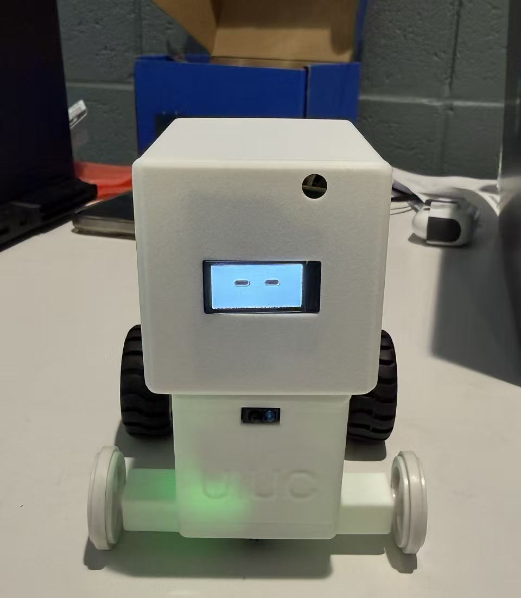
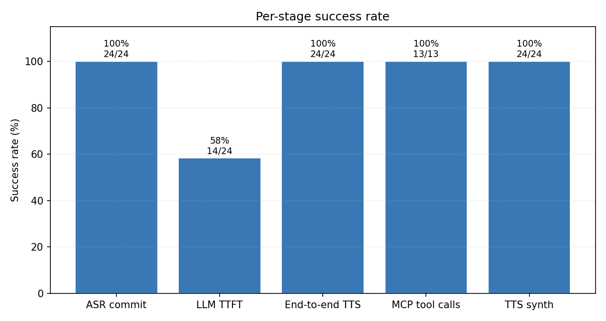

# Week 9 Engineering Notebook

**Date:** April 13 – April 19

## Objectives

- Add a noise-floor estimator to follow mode and re-test in a noisier room.
- Run a structured regression checklist on the first fully assembled robot.
- Coordinate the full assembly week with Yuchen so the head, body, head PCB, body PCB, head battery, body battery, sensors, screen, mic, and speaker are all in the chassis at once.
- Verify communication and power correctness once everything is integrated.

## Work Completed

The full assembly came together this week. Yuchen had the printed exterior matching the PCB dimensions, and we put every module — head PCB, body PCB, two batteries, both sensors, screen, mic, speaker — into the case. From my side this meant running a regression checklist to make sure nothing changed silently when the wiring tightened up inside the case.

Follow mode noise-floor estimator:

- Slow exponential moving average of energy.
- Threshold = floor + delta. Delta is currently a fixed value tuned by hand.
- The estimator only updates during silence-like windows so a long sentence does not raise the floor.
- In a noisier room, the false-rotation rate dropped substantially compared to last week's fixed threshold. There are still edge cases (a sudden loud event can trip a single rotation before the floor catches up), but it is better.

Regression checklist (first full assembly):

1. USB power-on, full boot, web panel reachable. ✓
2. All seven LCD states render correctly. ✓
3. D-pad drives both motors. ✓
4. Voice "move forward" / "stop" works end-to-end. ✓
5. Dance routine completes; LCD reflects state; cliff preemption works mid-dance. ✓
6. Follow mode enters/exits and behaves with the new noise-floor estimator. ✓
7. Cliff event over front edge stops the robot. ✓
8. Cliff event over rear edge stops the robot. ✓
9. Battery-powered vs. USB-powered behaves equivalently in a fixed location. ✓
10. PA mute at boot (no click). ✓

Discussion items with Zichao on the integrated power check:

- We powered the assembled robot on after final wiring and confirmed every module receives power.
- Verified soldering quality; no obvious cold joints; circuit integrity good. Matches his weekly note from this week.

Discussion items with Yuchen on the integrated chassis:

- Wire routing is tight inside the head; we agreed to fold the LCD FPC under the screen rather than over so the head closes flush.
- Motor wires from the body PCB to the motors are long enough not to pull on the connector under load.

## Design Notes

### Noise-floor estimator

- Per-frame energy from VAD path goes into a slow EMA: `floor = (1 - α) * floor + α * E`.
- Update gated on "this frame is probably not voice" — using the existing VAD output as a hint.
- Threshold = `floor + delta`, with `delta` tuned once for our typical desk environment.

### Regression checklist

- Going forward, I'll re-run this list before any milestone demo.
- Each item has a one-line pass/fail in a small text file; runs are timestamped.

### Hardware notes from Zichao discussion

- All modules powered correctly after assembly.
- No re-work on solder joints needed.
- Battery rails (head and body) both behave under load.

### Exterior notes from Yuchen discussion

- LCD FPC routing fixed by folding under, not over.
- Motor wire length verified.
- Sensor windows still aligned post-assembly.

### Tradeoffs noted

- Noise-floor adaptive threshold vs. fixed: adaptive wins; the small extra complexity is worth the reduction in false rotations.
- Single regression checklist vs. automated test harness on hardware: a checklist is fine for a single robot at this stage. An automated harness would be the right call for a fleet.

## Diagrams and Figures

**Figure 1. The fully assembled robot on the bench during the regression checklist run, with both batteries inside, all sensors wired, and the LCD rendering the idle face. The body PCB power LED is visible as a green glow at the bottom of the body shell, and the front IR cliff sensor module is centered just below the head/body seam.**

This is the first photograph of the complete system running with everything inside the printed exterior. As shown in Figure 1, the LCD face fits cleanly inside the head opening (no visible bezel from a normal desk-viewing distance), the IR cliff sensor sits where Yuchen and I placed it, and the printed body is wide enough to host both batteries and the body PCB without forcing the wires against the chassis. Every checklist item below was run with the robot in this exact assembled configuration.

**Figure 2. Per-stage success rate across the regression run on the fully assembled robot: ASR commit, end-to-end TTS, MCP tool calls, and TTS synth at 100% (24/24, 24/24, 13/13, 24/24). LLM TTFT at 58% (14/24).**

As shown in Figure 2, assembly did not regress any of the per-stage success numbers compared to the dev-board sandbox in Week 6 — the firmware/hardware boundary held up. The LLM TTFT line is identical to before because LLM behavior is independent of which board the firmware runs on, which is the result I wanted to see.

## Equations and Calculations

Adaptive threshold:

\[
\text{floor}(t) = (1 - \alpha) \cdot \text{floor}(t-1) + \alpha \cdot E(t)
\]

\[
\text{trigger} \;\Leftrightarrow\; E(t) > \text{floor}(t) + \Delta
\]

**Equation 1. Slow-EMA noise floor and trigger condition for follow mode.**

Where:
- \(\alpha\) is the EMA constant; small (`[measured]`).
- \(\Delta\) is the delta above the floor that counts as a voice event.
- \(E(t)\) is the per-frame energy from Equation 1 in Week 8.

Battery runtime estimate (re-stated, now that we can measure):

\[
t = \frac{C}{I_{avg}}
\]

**Equation 2. Approximate runtime.**

Where \(C\) is `[battery capacity]` and \(I_{avg}\) is `[measured current]` averaged across an idle + occasional motion mix.

## Testing and Debugging

### Test 1: Follow mode in a noisier room

**Goal:** Confirm the adaptive threshold reduces false rotations.

**Setup:** Assembled robot on desk, follow mode active, room with a fan and background music at moderate level.

**Input Conditions:** 5 minutes of ambient + 10 short voice phrases.

**Expected Result:** Rotations only on voice phrases; ambient does not trip rotations.

**Observed Result:** No false rotations from ambient. Voice triggers correctly. One spurious rotation from a short loud event before the floor caught up.

**Analysis:** Big improvement over the fixed threshold; the tail case is acceptable.

**Decision / Next Step:** Keep adaptive. Document the tail case.

### Test 2: Full regression checklist

**Goal:** Confirm everything works after final assembly.

**Setup:** Assembled robot on desk, both batteries connected, USB available for fallback.

**Input Conditions:** Run the 10-item list above.

**Expected Result:** All ten pass.

**Observed Result:** All ten pass.

**Analysis:** Assembly is solid.

**Decision / Next Step:** Re-run before each milestone demo.

### Test 3: Cliff event during dance, on real chassis

**Goal:** Confirm dance preemption works with real motors and a real edge.

**Setup:** Robot at the edge of the desk, dance triggered with the rear of the robot near the edge.

**Input Conditions:** Trigger dance; let the routine drive the robot rearward over the edge while it's still hand-supported.

**Expected Result:** Cliff event fires; motors stop within `[latency result]` ms; LCD switches to `safety_stop`.

**Observed Result:** Stops in under one motor revolution. LCD switches.

**Analysis:** Safety preemption works on assembled hardware.

**Decision / Next Step:** Always test this on a held robot, not free-running, to avoid actual falls.

## Problems and Proposed Solutions

**Problem:** Tail-case false rotation in follow mode after a sudden loud event.
- **Evidence:** Test 1.
- **Possible cause:** Floor is slow to track sudden changes by design.
- **Proposed solution:** Could add a fast-attack/slow-decay variant if it becomes an issue. Not blocking now.

**Problem:** LCD FPC routing was tight in the assembled head.
- **Evidence:** Initial fitting before re-routing.
- **Possible cause:** Cable length and direction.
- **Proposed solution:** Fold under the screen, not over. Done with Yuchen.

## Revisions

- Follow mode: adaptive noise-floor threshold.
- Logging: regression checklist runs are saved as a tagged log file.
- Cable routing: head FPC folded under per Yuchen.

## Next Steps

- Build out the web panel beyond the v1 D-pad — add mode buttons, status display, latency readout.
- Start a focused latency-tuning pass on the voice path.
- Plan the demo flow and capture a video.
- Reuse the regression checklist before recording the demo.
