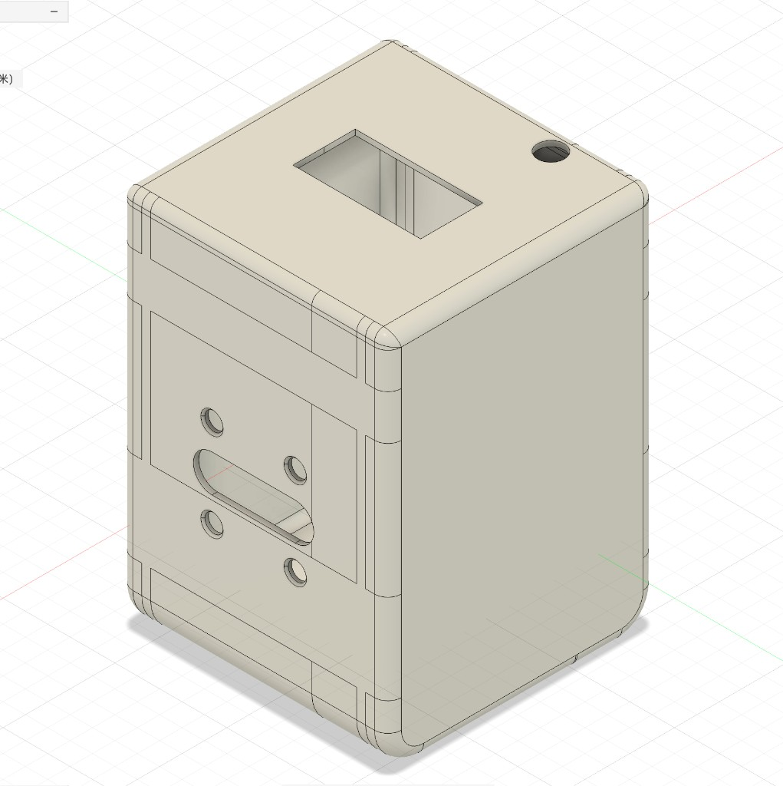
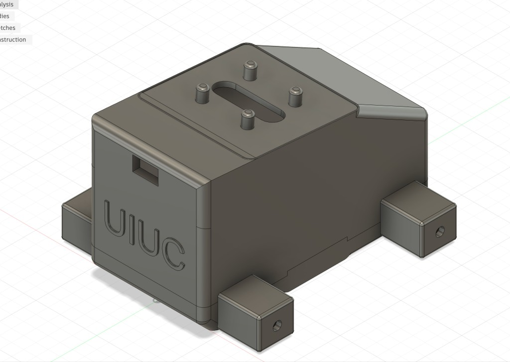

# Week 11 Engineering Notebook

**Date:** April 27 - May 4

## Objectives

- Lock the final mechanical design and enclosure dimensions.
- Document the final robot exterior, internal layout, and assembly result.
- Support final demonstration and report preparation.

## Work Completed

This week I finalized the mechanical side of the robot. After multiple Fusion 360 revisions, physical fitting attempts, and assembly checks, the final enclosure dimensions were confirmed to work with the real hardware. The head, body, wheel hub, center axle, openings, sensors, PCB locations, two batteries, two motors, four wheels, rear charging access, four snap-fit head/body connection points, large PCB wiring pass-through, and wiring all fit into the final physical design.

I confirmed the final appearance of the robot. The head contains the head PCB, head battery, screen, microphone opening, speaker module, and speaker opening. The body contains the body PCB, body battery, two motors, four wheels, one axle, two sensor openings, rear charging access, and the movement/sensing hardware. The head and body connect through four snap-fit points, and a large pass-through opening between them allows wiring between the head PCB and body PCB. The screen remains the main face of the robot, while the body supports motion, sensing, charging access, and internal electronics.

In the final appearance pass, I also added exterior styling details so the robot would look more like a completed ECE 445 project instead of only a functional enclosure. The most important added detail was the `UIUC` mark on the front of the body. This makes the design more personalized to the University of Illinois project context and gives the front body surface a more intentional visual identity.

I also helped prepare the final documentation by organizing what should be shown in photos: the exterior appearance, the head and body structure, the wheel/axle area, the two PCB fits, the sensor placement, the rear charging opening, and the complete assembled robot. These records are important because they show the progression from design idea to working physical prototype.

I also kept the earlier measurement and sketch PDF with the final notebook documentation: [mechanical_measurements_and_sketches.pdf](references/mechanical_measurements_and_sketches.pdf). This file records the practical measurement process for the head/body PCBs, motors, screen, batteries, sensors, wheels, axle, openings, four snap-fit points, PCB wiring pass-through, rear charging access, and UIUC exterior mark before the final Fusion 360 version was completed.

## Design Notes

### Final mechanical configuration

- Head designed for head PCB, head battery, screen, microphone opening, speaker module, and speaker opening.
- Body designed for body PCB, body battery, two motors, four wheels, one axle, two sensors, rear charging opening, and wiring.
- Wheel hub and center axle integrated into the body design.
- Front-facing body sensor supports obstacle detection.
- Downward-facing body sensor supports desk-edge detection.
- Rear body opening supports charging access.
- Four snap-fit points connect the head and body.
- Large pass-through opening allows wiring between the head PCB and body PCB.
- Final enclosure dimensions match real assembly constraints.

### Final design reasoning

- The robot uses a clear head/body split so interaction and movement functions are visually separated.
- The screen is the main expressive feature, keeping the front design clean.
- The body is compact but large enough for internal hardware and wiring.
- Additional exterior styling, including the `UIUC` front-body mark, makes the final enclosure look more complete and project-specific.
- Multiple physical versions were necessary because real assembly constraints cannot be fully predicted in CAD.

## Diagrams and Figures

**Figure 1. Final robot exterior.**

Description: Shows the completed head, body, wheels, and overall companion-robot appearance.

**Figure 2. Final body exterior with UIUC mark.**

Description: Shows the final body shape with wheel supports, top mounting slot, rear charging access, and the added `UIUC` mark on the front surface.

**Figure 3. Final internal hardware layout.**

Description: Shows head/body PCBs, head/body batteries, sensors, screen, microphone, speaker module, two motors, four wheels, one axle, rear charging opening, snap-fit interface, PCB wiring pass-through, and wiring in the enclosure.

**Figure 4. Wheel hub and center axle final design.**

Description: Shows the mechanical interface between the two-motor, four-wheel system, one center axle, and body structure.

**Figure 5. Final sensor placement.**

Description: Shows the front-facing body sensor for obstacle detection and downward-facing body sensor for desk-edge detection.

## Equations and Calculations

Final fit requirement:

\[
C_{final} > 0
\]

**Equation 1. Final physical clearance condition.**

Every installed component must have positive clearance after accounting for printed dimensions, wires, openings, and assembly tolerance.

## Testing and Debugging

### Test 1: Final assembly verification

**Goal:** Confirm that the final enclosure can contain all hardware modules.

**Setup:** Final printed enclosure with head/body PCBs, head/body batteries, two motors, four wheels, one axle, two sensors, screen, microphone, speaker module, four snap-fit points, PCB wiring pass-through, rear charging access, and wiring.

**Input Conditions:** Assemble the complete robot and inspect fit.

**Expected Result:** All components fit without forcing the enclosure.

**Observed Result:** Final assembly fit was successful.

**Analysis:** The final dimensions are correct for the prototype.

**Decision / Next Step:** Use this final version for demonstration and documentation.

### Test 2: Final appearance and documentation review

**Goal:** Confirm the design is ready to present as a completed physical prototype.

**Setup:** Fully assembled robot.

**Input Conditions:** Inspect exterior appearance, openings, wheel placement, sensor windows, and internal layout.

**Expected Result:** Robot appears complete and the mechanical design decisions are visible in documentation.

**Observed Result:** Final robot appearance and dimensions are acceptable for the project demo.

**Analysis:** Mechanical design work is complete.

**Decision / Next Step:** Finish final report and demo materials.

## Problems and Proposed Solutions

**Problem:** The final enclosure had to satisfy both appearance and hardware constraints.
- **Proposed solution:** Use iterative Fusion 360 revisions and physical fitting to converge on the final dimensions.

**Problem:** CAD alone could not predict every assembly issue.
- **Proposed solution:** Build multiple versions, test real component fit, modify dimensions, and repeat until assembly worked.

## Revisions

- Finalized head, body, wheel hub, center axle, four snap-fit points, PCB wiring pass-through, rear charging access, and opening locations.
- Added final exterior styling details, including the `UIUC` mark on the front body surface.
- Confirmed final dimensions through full assembly.
- Documented final exterior and internal layout.
- Prepared mechanical design content for final report and demo.

## References

[1] Final Fusion 360 model.  
[2] Final assembly photos.  
[3] ECE 445 final report and demo requirements.  
[4] [Mechanical measurements and sketches PDF](references/mechanical_measurements_and_sketches.pdf).

## Next Steps

The senior design prototype is complete. If the project continued, possible mechanical improvements would include:

- Add more formal screw bosses or snap-fit features.
- Improve wire strain relief.
- Reduce unused internal clearance after final measurements.
- Make the head and body batteries easier to remove and replace.
- Improve manufacturability beyond the one-off 3D-printed prototype.
