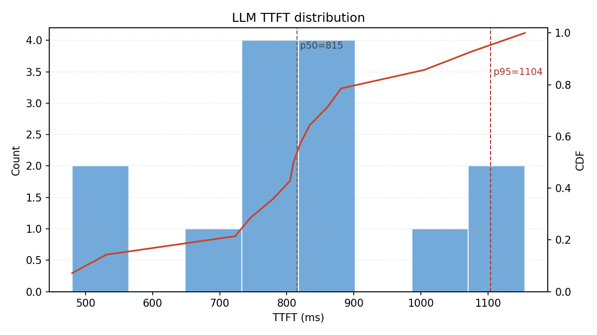
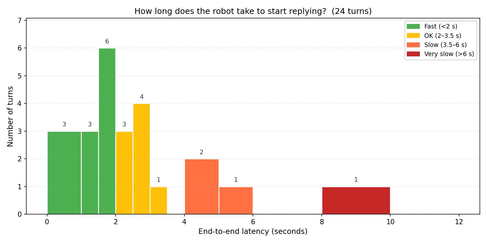
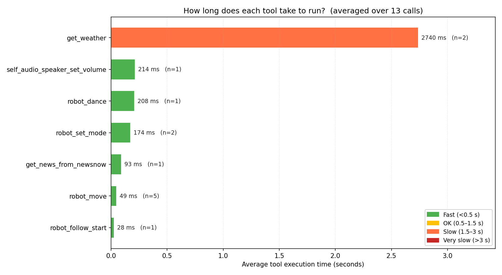
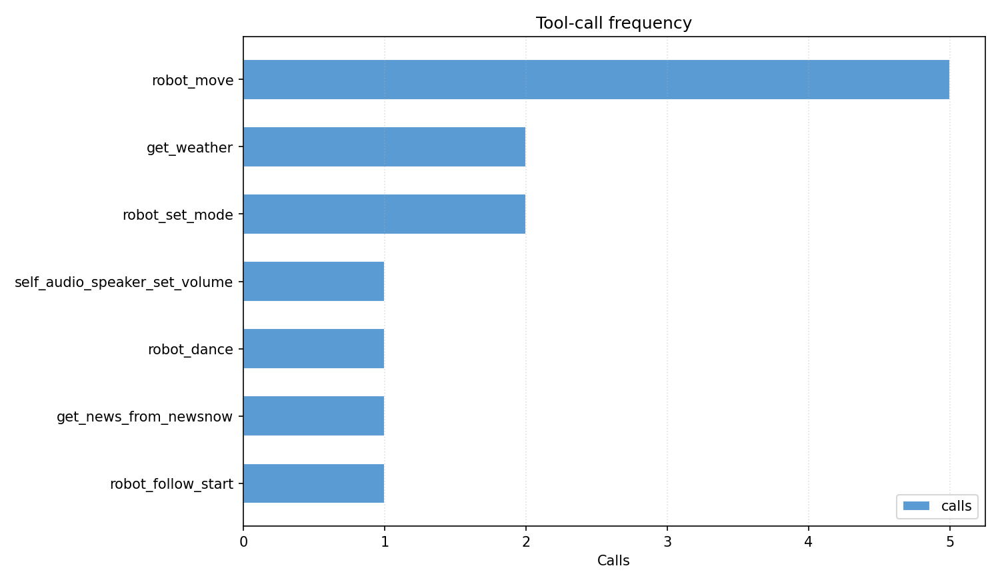
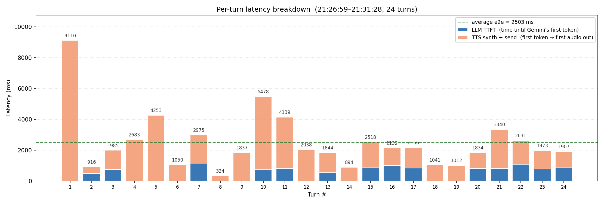
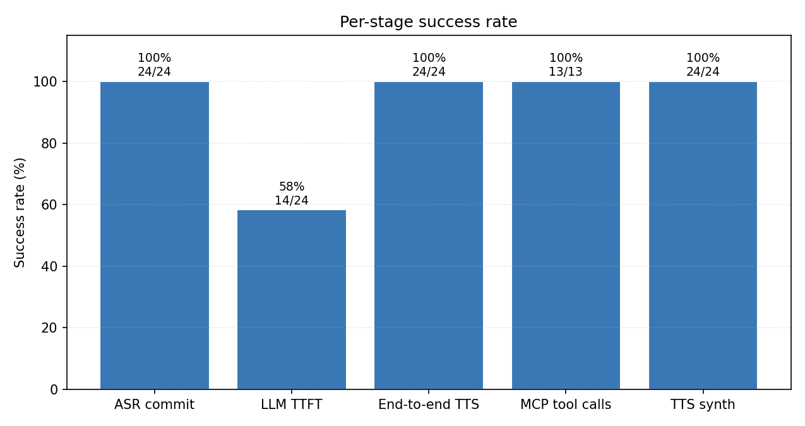

# Jarvis voice pipeline — performance report

_Generated by `analyze_metrics.py` on 2026-04-28 21:53:46_

## Summary

- Log window: **409 s**
- Turns parsed: **24**
- Wake greetings: **1**
- Aborts (barge-in): **0**
- Echo-guard drops: **0**
- Tool calls: **13** (timeouts: 0)

### LLM TTFT (ms)

- n=14, mean=822, p50=815, p95=1104, max=1155

### End-to-end ASR→first TTS (ms)

- n=24, mean=2503, p50=2012, p95=5294, max=9110

### Per-tool latency (ms)

| Tool | n | p50 | p95 | max | actions |
|------|--:|----:|----:|----:|---------|
| `robot_move` | 5 | 32 | 93 | 100 | Action.RESPONSE:5 |
| `get_weather` | 2 | 2740 | 5205 | 5479 | Action.RESPONSE:2 |
| `robot_set_mode` | 2 | 174 | 215 | 219 | Action.REQLLM:2 |
| `self_audio_speaker_set_volume` | 1 | 214 | 214 | 214 | Action.REQLLM:1 |
| `robot_dance` | 1 | 208 | 208 | 208 | Action.RESPONSE:1 |
| `get_news_from_newsnow` | 1 | 93 | 93 | 93 | Action.RESPONSE:1 |
| `robot_follow_start` | 1 | 28 | 28 | 28 | Action.RESPONSE:1 |

## Plots

### LLM TTFT distribution

### End-to-end ASR→TTS latency

### MCP / plugin tool latency

### Tool call frequency

### Latency over time

### Per-stage success rate

